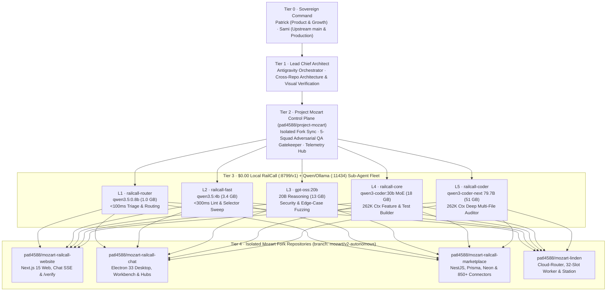
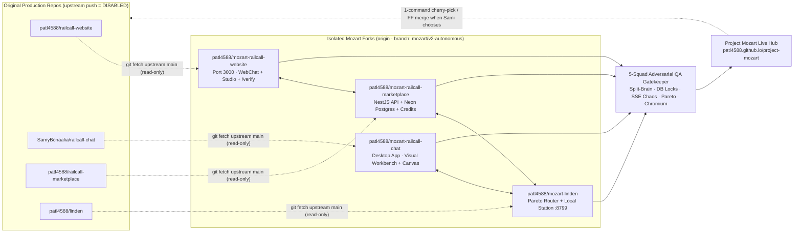

# Project Mozart v2 — Isolated Fork Architecture, $0 Qwen/Ollama Sub-Agent Hierarchy & Perpetual Goal Ratchets

> [!IMPORTANT]
> **Zero-Pollution Guarantee:** All 4 RailCall repositories are now forked into isolated private `patl4588/mozart-*` repositories on a brand-new branch **`mozart/v2-autonomous`**. Every local repository has `git remote set-url --push upstream DISABLED` enforced at the Git layer and verified by the QA Gatekeeper—making it mathematically impossible to push to Sami's production repositories.

---

## 1. Command & Sub-Agent Hierarchy

### Local $0.00 Sub-Agent Fleet (`mozart_local_swarm.py`)

| Tier | CLI Key | Local Model | Underlying Weights | Footprint & Context | Role in Perpetual Build |
| :--- | :--- | :--- | :--- | :--- | :--- |
| **L1** | `--subagent router` | `railcall-router:latest` | `qwen3.5:0.8b` | `1.0 GB` · `<100ms` | Instant task classification, repo targeting, and file-slice routing |
| **L2** | `--subagent fast` | `railcall-fast:latest` | `qwen3.5:4b` | `3.4 GB` · `<300ms` | Dead-link scanning, CSS/DOM selector audits, and JSON schema checks |
| **L3** | `--subagent security` | `gpt-oss:20b` | `gpt-oss:20b` | `13 GB` · Low-think | Adversarial SSRF, HMAC cookie split-brain, and auth airlock fuzzing |
| **L4** | `--subagent core` | `railcall-core:latest` | `qwen3-coder:30b` MoE | `18 GB` · `262K ctx` | TypeScript / NestJS / Next.js / Electron implementation & unit test synthesis |
| **L5** | `--subagent coder` | `railcall-coder:latest` | `qwen3-coder-next` 79.7B | `51 GB` · `262K ctx` | Deep multi-file AST audits, surgical diff verification, and PR review |

---

## 2. Current System & Isolated Git Architecture

---

## 3. Ongoing Compounding Goal Ratchets ("Never Stop Building")

Every autonomous wave follows a strict **Non-Regression Ratchet**: test counts, speed, coverage, and UX polish can only move **upward**, gated by the 5-Squad QA Gatekeeper before pushing to `mozart/v2-autonomous`.

| Engineering Track | Current Verified Baseline | Wave +1 Target | Wave +2 Target | Perpetual North Star |
| :--- | :--- | :--- | :--- | :--- |
| **1. Router Intelligence & Speed (`mozart-linden`)** | `48/48` Pareto groups · `-95.4%` vs Frontier · `-22.4%` latency vs OR | `96` workload groups · prefix-cache telemetry · p95 TTFT `<380ms` | `150` workload groups · `85%+` cache hit · `<120ms` pre-stream failover | `200+` live-calibrated workloads · sub-`250ms` TTFT · Ed25519 receipts on 100% of hops |
| **2. Visual Builder, Workflows & Agents UX (`chat` + `website`)** | `828` desktop tests + `161` web routes · Tabbed Desktop Hubs + Visual Build Guard | Full Web/Desktop UI parity on Workflows & Agents tabs · `<15s` first-pixel preview | `50+` 1-tap vertical kits (checkout, SaaS, CRM, legal/finance PDFs) · zero broken links (`390/768/1440px`) | `<10s` live visual preview · instant visual point-and-edit + 1-click deploy |
| **3. Marketplace, Billing & Connectors (`marketplace`)** | `109/109` specs · Stateless HMAC cookie · Prisma `WorkspaceImage` | Top-25 SaaS connectors (Stripe, Slack, Gmail, Neon, Linear, GitHub) live dry-run probes | `1,000-RPS` burst queue soak · zero-drift idempotent credit ledger audit | Multi-region HA + tamper-evident clearing-house audit trail across 850+ connectors |
| **4. $0 Qwen Sub-Agent Factory & QA (`project-mozart`)** | `5` local models wired · `29/29` 5-Squad Gate · `1,033+` total assertions | Automated L2 (`railcall-fast`) + L4 (`railcall-core`) pre-gate sweep · `1,250+` assertions | `75%+` grunt-work offloaded to `$0` local Qwen GPU · `1,500+` assertions | 24/7 autonomous scout → build → fuzz → verify → publish loop at near-`$0` marginal cost |

---

## 4. Continuous Execution Loop (Every Wave)

1. **Sync Read-Only Upstream:** `git fetch upstream main` across all 4 repos (keeping `mozart/v2-autonomous` conflict-free with Sami's latest `main`).
2. **Scout ($0 Local Qwen L1 + L2):** `railcall-router` & `railcall-fast` scan diffs, routes, selectors, and open KPI gaps.
3. **Build & Synthesize (Lead Architect + Qwen L4/L5):** Implement targeted upgrades & unit tests on `mozart/v2-autonomous` (`railcall-core` 30B & `railcall-coder` 79.7B assist at `$0.00`).
4. **Adversarial Fuzz & 5-Squad Gate (`L3` + `run-qa-gate.mjs`):** Run `gpt-oss:20b` security probes + all repo test suites (`828 + 96 + 109 + 48`) + 5-Squad Chaos/Chromium Gatekeeper.
5. **Publish Isolated Fork & Live Scorecard:** Push verified commits exclusively to `patl4588/mozart-*` (`mozart/v2-autonomous`) and publish updated diffs & telemetry to `https://patl4588.github.io/project-mozart/`.
